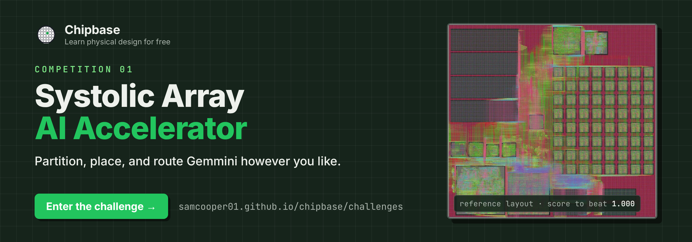
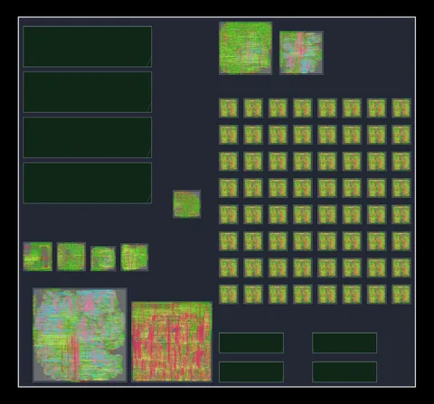
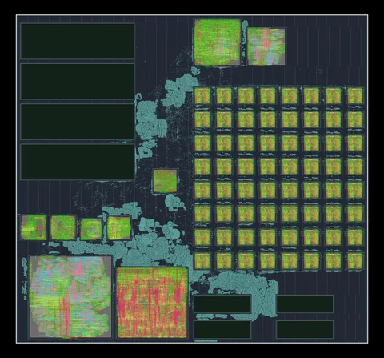
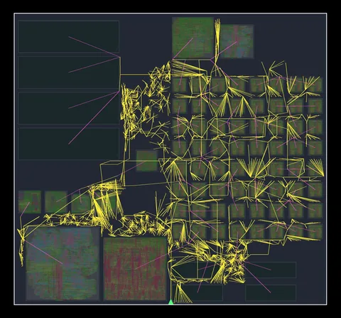
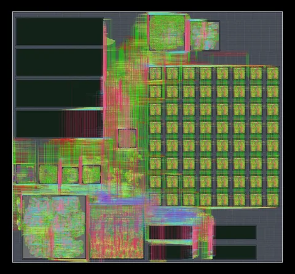
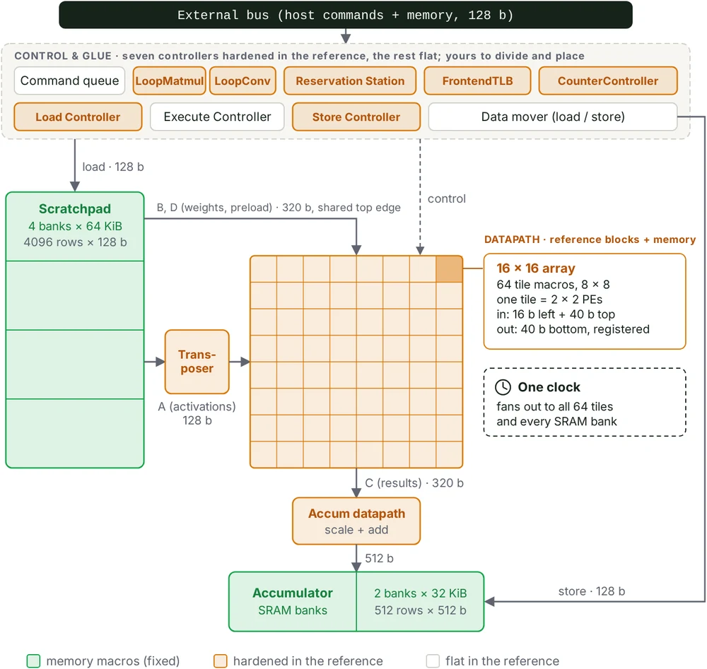

# Chipbase Competition 01: Systolic Array AI Accelerator

  &nbsp;&nbsp;&nbsp;&nbsp;
  &nbsp;&nbsp;&nbsp;&nbsp;
  &nbsp;&nbsp;&nbsp;&nbsp;
  

  
   
  <b><a href="https://samcooper01.github.io/chipbase/challenges">The challenge page</a></b>: the design, the rules, the scoring, and how to begin.

This repository is the evaluation harness for the first design competition on Chipbase, a free site
for learning physical design. Entrants implement Gemmini [1], an open-source AI accelerator built
around a 16 by 16 systolic array [2], from RTL to a complete layout in the ASAP7 predictive process
[3], using only open-source tools. Partitioning, placement, and routing are left to the entrant. Every
entry that passes all gates is scored on clock period, area, and power relative to the reference
flow included here.

| Floorplan | Placement | Clock tree | Routing |
|:---:|:---:|:---:|:---:|
|  |  |  |  |
| macros placed by hand | about 200,000 cells | one tree, about 35,000 registers | nine metal layers, no shorts or via violations |

<b>Figure 1.</b> The reference implementation at four stages of the flow.

## Getting started

Requirements: Docker, 16 or more hardware threads, 64 GB of memory, and about 120 GB of disk. Every
tool comes from one pinned container image, the OpenROAD-flow-scripts project's own.

    git clone https://github.com/Samcooper01/systolic-array-ai-accelerator-harness
    cd systolic-array-ai-accelerator-harness
    docker run --rm -it -v "$PWD":/work -w /work \
      openroad/orfs@sha256:6bc088ee563c76374f7ef5d0a3244d607a6162c8979f1815f92eef683c1169a4 bash

    # inside the container:
    ./setup.sh                  # links the container's tools and checks them
    ./run_baseline.sh           # the reference flow, into baseline/ (about 5 to 6 hours)
    ./evaluate.sh baseline/     # every gate and the score (about an hour)

Expected result: every gate passes and the score is 1.000. The full report is written to
`eval_work/baseline/evaluation.json`.

## Building an entry

An entry is a git repository of source only: `reproduce/Dockerfile` defines its container, and
`reproduce/run.sh` builds the layout from the pinned inputs. This repository's `reproduce/` already
packages the reference this way, so the simplest start is to fork it and modify the flow in `flow/`.

1. **Iterate** inside the container:

       ./run_baseline.sh           # runs your flow into baseline/
       ./evaluate.sh baseline/     # every gate and the score

2. **Test** once before submitting. Commit your work, then run the official runner in a terminal
   on your own machine, outside the container (it starts containers itself):

       judge/run_entry.sh

   It builds and runs your latest commit exactly as the official run does and scores it (about 6 to
   7 hours for the reference). The score lands in `eval_work/mine/evaluation.json`. It needs Git
   and Python 3; for an entry that is not a fork of this repository, give its location and commit:
   `judge/run_entry.sh <path or URL> <commit>`.

3. **Submit** by opening an issue on this repository with the entry's repository, the commit, and
   the `evaluation.json`.

The full specification is in `submission/README.md`.

## Reference implementation

The reference flow runs on OpenROAD-flow-scripts: Yosys [4] for synthesis, then OpenROAD [5] for
floorplanning, global placement [6], clock tree synthesis, and detailed routing [7]. Its
configuration (`flow/gemmini/config_tight2.mk`) dissolves the hierarchy of the array and the memory
subsystem, placing their contents at the top level beside ten hardened block types.

  
   
  <b>Figure 2.</b> Gemmini as partitioned by the reference: fixed memory macros in green, hardened blocks in orange, flat logic in white.

| Block | Instances | Function |
|---|---|---|
| `Tile` | 64 | 2 by 2 processing elements, in an 8 by 8 grid |
| `AlwaysOutTransposer` | 1 | Transposes operand A |
| `AccumulatorScale` | 1 | Scaling and activation at the accumulator output |
| `LoopConv`, `LoopMatmul` | 1 each | Convolution and matrix-multiply loop unrollers |
| `ReservationStation` | 1 | Command issue and completion tracking |
| `LoadController`, `StoreController` | 1 each | DMA command controllers |
| `FrontendTLB`, `CounterController` | 1 each | Address translation; performance counters |
| Top level | | About 200,000 flat cells, the 8 SRAM macros, and all block instances |

<b>Table 1.</b> The reference partition: ten hardened block types and the top level.

The floorplan was drawn by hand with the editor in `flow/fpedit/` and saved as
`flow/gemmini/macro_place_tight2.tcl`: tiles on the right, scratchpad banks on the left, accumulator
memories below the array, and controllers around the edges, on an 821 by 765 µm die. Beyond stock
OpenROAD-flow-scripts, the flow adds:

- **Power grid** (`pdn_top_flat_M8M9.tcl`): an M8/M9 mesh with local M5 to M7 grids over the macros.
- **Array channels** (`array_pipe_hold.tcl`, `array_pipe_release.tcl`): the array's pipeline
  registers are held between the tiles during global placement.
- **Slew limit** (`constraint_drv.sdc`): forces buffering of long inter-block nets, which the block
  timing models leave unconstrained. The evaluator does not yet check slew.
- **Hold closure loop** (`flow/eco_hold.tcl`): repairs hold on extracted parasitics and reroutes
  until the routed layout meets hold.
- **Two-corner timing**: the flow runs at the fast corner, with slow-corner block models
  (`flow/slow_abstract.tcl`) and a slow-corner period search (`flow/time_at_period.tcl`).

Entrants may change any of this. What binds them is the result, which the gates check: timing at
both corners, IR drop, design rules, equivalence, and the compute budget.

## Details

[Problem definition](#problem-definition) ·
[Rules](#rules) ·
[Scoring](#scoring) ·
[Evaluation gates](#evaluation-gates) ·
[Reference results](#reference-results) ·
[Repository layout](#repository-layout) ·
[References](#references)

### Problem definition

Fixed and identical for all entrants:

- **Design.** Gemmini at a pinned configuration: 8-bit integer inputs; a 16 by 16 array of
  multiply-accumulate processing elements, built as an 8 by 8 mesh of 2 by 2 tiles; a 256 KiB
  scratchpad in 4 banks; a 64 KiB accumulator in 2 banks; inference only. Supplied as Verilog in
  `design/rtl/`, generated from Gemmini's Chisel [8] source with Chipyard [9].
- **Process.** ASAP7 as shipped in OpenROAD-flow-scripts at the pinned commit, with FakeRAM2.0 SRAM
  macros for the two memories (`design/srams/`).
- **Constraints.** `flow/gemmini/constraint.sdc`, in which the clock period is the only free value.
  One clock; input-to-register and register-to-output paths within 80 percent of the period,
  input-to-output within 60 percent; no clock uncertainty, input drive, output load, or false paths.
  The evaluator times every entry against this file.
- **Power workload.** `design/activity/`: the switching activity of one 128 by 128 by 128 tiled
  matrix multiplication, C = relu(scale × (A × B + D)), simulated on the golden RTL.

`versions.lock` records every pinned version.

### Rules

- **Permitted:** any open-source tools, stock or modified; custom open-source tooling in the entry's
  repository; any partitioning, from flat to finely hierarchical; any optimization; teams; and
  resubmission, with the best score counting.
- **Prohibited:** commercial or proprietary tools, libraries, or IP; changing the design's function
  or interface; changing synthesis in any way (no retiming, scan insertion, or register changes
  beyond what the pinned synthesis produces); modifying fixed inputs, constraints, the evaluator, or
  the runner; network access during the build; shipping a finished placement, routing, or gate-level
  netlist.
- **Chosen by the entrant:** the clock period; die size, aspect ratio, and utilization; I/O pin
  placement; clock-tree targets and useful skew; cell selection, including threshold-voltage mix;
  the power grid; and every other flow parameter.
- **Fixed:** the constraints apart from the period; the corners (setup at slow, hold at fast, power
  at typical); the 110 mV IR-drop limit; per-layer wire parasitics (M2 to M9); the switching
  activity.

### Scoring

$$
\mathrm{FOM} = \left(\frac{T_\mathrm{ref}}{T}\right)^{0.30} \cdot \left(\frac{A_\mathrm{ref}}{A}\right)^{0.50} \cdot \left(\frac{P_\mathrm{ref}}{P}\right)^{0.20}
$$

T is the declared clock period, at which the entry must pass setup; A is the die area; and P is the total power at a fixed 1,000 ps
clock under the pinned activity, so a slower clock does not lower it. Reference values are in Table 2.
Higher is better; the reference scores 1.000. Area weighs most because the die is almost entirely
blocks and memories, whose partitioning and packing set its size. The weights are fixed and will not
change once entries arrive.

### Evaluation gates

An entry is ranked only if it passes all eight gates. `./evaluate.sh` checks gates 1 to 7 from the
layouts alone, with the pinned tools; the official runner checks gate 8.

1. **Block integrity.** Every hardened block is placement-legal and fully routed.
2. **Timing.** Setup at the slow corner at the declared period and hold at the fast corner, on
   parasitics the evaluator extracts itself.
3. **Legality and routing.** No overlaps, every cell on the placement grid, no unrouted nets.
4. **Power integrity.** Worst static IR drop at most 110 mV.
5. **Design rules.** No shorts or via violations, per the detailed router's rule checker. Its other
   findings and the ASAP7 KLayout deck are informational, since both flag the reference throughout.
6. **Logical equivalence.** Every netlist is proven equivalent by ABC [10] to the evaluator's own
   synthesis of the golden RTL, so synthesis is fixed and everything after it is verified. A module
   ABC cannot finish is checked with 2,000,000 random vectors instead.
7. **Layout versus netlist.** Every layout's pin-level connectivity matches its netlist.
8. **Compute budget.** The longest dependency chain (block, enclosing block, top level) takes 12
   hours or less at 16 threads and 64 GB, as reported in the flow's `runtime.json` (wall-clock time
   if absent).

### Reference results

<!-- REF_RESULTS -->
| Metric | Reference |
|---|---|
| Declared clock period (slow-corner setup) | 6,391 ps (156 MHz) |
| Die area | 628,065 µm² (821 by 765 µm) |
| Total power (typical corner, 1,000 ps clock, pinned activity) | 1.3455 W |
| Worst static IR drop | 84.4 mV (limit 110 mV) |
| Hold (fast corner) | Met |
| Design-rule violations (shorts and vias) | 0 |
| Equivalence | 11 of 11 modules proven |
| Longest dependency chain (LoopConv, then top level) | 5.11 to 5.65 h of 12 h; peak 26.9 GB |
| Evaluator runtime | 57 to 64 min; peak 30 GB |

<b>Table 2.</b> Reference results, measured by the evaluator and the official runner.

Every run (fresh clones in the pinned container, and through the official runner; see `HANDOFF.md`)
gave identical period, area, and power. Multithreaded routing may still differ slightly on other
machines.
<!-- /REF_RESULTS -->

### Repository layout

    design/               fixed inputs: rtl/ (with licenses/), srams/, activity/, generator/
    flow/gemmini/         reference flow configurations, constraints, and scripts
    flow/eval/            the evaluator (tests/ holds the equivalence gate's regression test)
    flow/fpedit/          the floorplan editor
    flow/render/          scripts that render the layout images
    reproduce/            the reference packaged as an entry
    judge/                the official runner and the clean-machine test
    setup.sh              links the pinned tools
    run_baseline.sh       runs the flow
    evaluate.sh           runs the evaluator
    scoring.yaml          gates, weights, and reference values
    versions.lock         every pinned version
    submission/           the submission specification
    docs/                 README images and banner sources
    HANDOFF.md            development record

    generated, not tracked: work/ (about 40 GB per run), baseline/, judge_work/, eval_work/

### References

1. H. Genc et al., "[Gemmini: Enabling Systematic Deep-Learning Architecture Evaluation via
   Full-Stack Integration](https://arxiv.org/abs/1911.09925)," in *Proc. 58th ACM/IEEE Design
   Automation Conference*, 2021.
2. H. T. Kung, "[Why Systolic
   Architectures?](https://www.cs.virginia.edu/~smk9u/CS6501F19/kung_-_1982_-_why_systolic_architectures.pdf),"
   *Computer*, vol. 15, no. 1, pp. 37-46, January 1982.
3. L. T. Clark et al., "[ASAP7: A 7-nm FinFET Predictive Process Design
   Kit](https://asu.elsevierpure.com/en/publications/asap7-a-7-nm-finfet-predictive-process-design-kit/),"
   *Microelectronics Journal*, vol. 53, pp. 105-115, July 2016.
4. C. Wolf and J. Glaser, "[Yosys: A Free Verilog Synthesis
   Suite](https://research.jku.at/en/publications/yosys-a-free-verilog-synthesis-suite/)," in
   *Proc. Austrochip Workshop on Microelectronics*, 2013, pp. 47-52.
5. T. Ajayi et al., "[Toward an Open-Source Digital Flow: First Learnings from the OpenROAD
   Project](https://par.nsf.gov/biblio/10171025)," in *Proc. 56th Annual Design Automation
   Conference*, 2019, pp. 76:1-76:4.
6. C.-K. Cheng, A. B. Kahng, I. Kang, and L. Wang, "[RePlAce: Advancing Solution Quality and
   Routability Validation in Global Placement](https://doi.org/10.1109/TCAD.2018.2859220)," *IEEE
   Transactions on Computer-Aided Design of Integrated Circuits and Systems*, vol. 38, no. 9,
   pp. 1717-1730, 2019.
7. A. B. Kahng, L. Wang, and B. Xu, "[TritonRoute: The Open-Source Detailed
   Router](https://doi.org/10.1109/TCAD.2020.3003234)," *IEEE Transactions on Computer-Aided Design
   of Integrated Circuits and Systems*, vol. 40, no. 3, pp. 547-559, 2021.
8. J. Bachrach et al., "[Chisel: Constructing Hardware in a Scala Embedded
   Language](https://aspire.eecs.berkeley.edu/projects/chisel-constructing-hardware-in-a-scala-embedded-language/),"
   in *Proc. 49th Design Automation Conference*, 2012.
9. A. Amid et al., "[Chipyard: Integrated Design, Simulation, and Implementation Framework for Custom
   SoCs](https://doi.org/10.1109/MM.2020.2996616)," *IEEE Micro*, vol. 40, no. 4, pp. 10-21, 2020.
10. R. Brayton and A. Mishchenko, "[ABC: An Academic Industrial-Strength Verification
    Tool](https://doi.org/10.1007/978-3-642-14295-6_5)," in *Computer Aided Verification (CAV 2010)*,
    LNCS 6174, pp. 24-40, 2010.

Pinned software:
[OpenROAD-flow-scripts @ bde10c7](https://github.com/The-OpenROAD-Project/OpenROAD-flow-scripts/tree/bde10c79a2389ffe9c5d73445f177f81262059f9) ·
[container image](https://hub.docker.com/r/openroad/orfs) (tag 26Q3-48-gbde10c79a) ·
[Gemmini @ 8c8b38b](https://github.com/ucb-bar/gemmini/tree/8c8b38b9dea3e4d6ba9695346a883b2094bd7388) [1] ·
[Chipyard 1.11.0 @ ac58f38d](https://github.com/ucb-bar/chipyard/tree/ac58f38d77c99e9d1cafa64dfd6d4b00bdcd43e1) [9] ·
[FakeRAM2.0 @ 8e6cd66](https://github.com/The-OpenROAD-Project/FakeRAM2.0/tree/8e6cd664f8d5f42ae684c8846a536f66c9d22ae8) ·
[OpenROAD](https://github.com/The-OpenROAD-Project/OpenROAD) [5] ·
[Yosys](https://github.com/YosysHQ/yosys) [4] ·
[ABC](https://github.com/berkeley-abc/abc) [10] ·
[KLayout](https://www.klayout.de)

## About

Chipbase Competition 01 was designed and built by Sam Cooper
([@Samcooper01](https://github.com/Samcooper01)). Questions, bug reports, and submissions go through
this repository's issues.

## License

The generated Verilog in `design/rtl/` keeps the licenses of the projects it was generated from
(Gemmini, Chipyard, and Rocket Chip); their texts are in `design/rtl/licenses/`.
